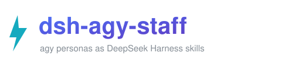

<p align="center"></p>

<p align="center"><a href="README.md">English</a> | <a href="README.zh-CN.md">简体中文</a></p>

<p align="center">   </p>

<p align="center">Install <a href="https://github.com/keli-wen/agy-staff">agy-staff</a>'s personas as DeepSeek Harness skills — <code>/agy-ask</code>, <code>/agy-staffer</code>, <code>/agy-researcher</code>, <code>/agy-reviewer</code>, <code>/agy-implementer</code>, plus <code>/agy-lead</code> and <code>/agy-jobs</code>.</p>

**[Why](#-why) · [Install](#install) · [Usage](#cujs) · [Core design](#core-design) · [Troubleshooting](#troubleshooting) · [Credits](#credits)**

## What & Why

[agy-staff](https://github.com/keli-wen/agy-staff) hires Google's Antigravity CLI (`agy`, Gemini 3.8 Flash) as a fast staffer for Claude Code, Codex, Pi and OpenCode. A senior agent hands it a survey, a review, or a scoped implementation, and gets a second model family back in seconds instead of grinding the same code itself.

**DeepSeek Harness is not one of the hosts it targets.** dsh has no plugin marketplace line like `claude plugin install`, no `/agy:` namespace, and no `$agy` skill picker. It does have a skills system: a SKILL.md bundle per skill, discovered from a filesystem root, invocable by the model through the `skill` tool and by you through `/name` in the composer.

This repo is the thin adapter between the two. It does not fork agy-staff and vendors none of its code: it reads your upstream checkout and publishes prefixed copies of the personas where dsh will find them.

| | Claude Code / Codex | DeepSeek Harness (this repo) |
|---|---|---|
| Surface | `/agy:ask`, `$agy:ask` | `/agy-ask` |
| Discovery | plugin manifest | `<dshHome>/skills/<name>/SKILL.md` |
| Shared resources | `<plugin-root>/companion` | junctions at `<dshHome>/companion`, `<dshHome>/docs` |
| Background jobs | host-specific wait | companion `wait` as a dsh background command |

## Install

**Step 1 — prerequisites.** Node.js (the companion is a Node script) and the [Antigravity CLI](https://antigravity.google/docs/cli/install):

```bash
curl -fsSL https://antigravity.google/cli/install.sh | bash
agy --version
```

On Windows the CLI installer drops `agy.exe` under `%LOCALAPPDATA%\agy\bin`; make sure that directory is on `PATH`.

**Step 2 — clone this repo and run the installer.** It locates an agy-staff checkout (or clones one to `~/agy-staff`), then publishes seven skills into `~/.dsh/skills`:

```powershell
git clone https://github.com/Adingo001/dsh-agy-staff.git
cd dsh-agy-staff
pwsh -File install.ps1                      # add -Check for a dry run
```

Already have a checkout somewhere? Point at it and nothing is cloned:

```powershell
pwsh -File install.ps1 -Upstream D:\project\agy-staff
```

**Step 3 — smoke test.** `ask` is tool-free, so it needs no setup and answers in about three seconds:

```powershell
node "$HOME\.dsh\companion\agy-companion.mjs" ask --prompt "reply with OK"
```

Then type `/agy` in the composer: seven rows, no restart needed — dsh watches the skills root and republishes its catalog.

## CUJs

| Use case | Type this |
|---|---|
| Quick second opinion | `/agy-ask what's your backend model` |
| General task | `/agy-staffer summarize the open TODOs in this repo` |
| Generate an image | `/agy-staffer generate a pixel-art robot mascot, save it as assets/mascot.png` |
| Review the working tree | `/agy-reviewer Review the current working tree` |
| Review a PR | `/agy-reviewer Review PR #12` |
| Challenge a plan | `/agy-reviewer Challenge the migration plan in docs/plan.md` |
| Survey a topic | `/agy-researcher how does auth work in this repo` |
| Scoped implementation | `/agy-implementer fix the flaky retry test` |
| Orchestrate a task | `/agy-lead investigate the options, draft a proposal, then revise it with my feedback` |
| Job ops | `/agy-jobs`, or just "is the agy job done?" |

Only `ask` blocks; the rest return a job id and the companion's `wait` collects the report. In dsh, run that `wait` as a background command so the host keeps working — one wait per job, `exit 2` means still running.

## Core design

Three layers, one of which is code:

1. **Upstream personas** — `skills/<persona>/SKILL.md` in agy-staff, plus `companion/agy-companion.mjs` (Node stdlib only) and `templates/`.
2. **`build-skills.ps1`** — the adapter. For each persona it copies the tree to `<dshHome>/skills/agy-<persona>`, rewrites `name: <persona>` to `name: agy-<persona>`, and rewrites cross-skill links (`../jobs/` → `../agy-jobs/`, `../reviewer/` → `../agy-reviewer/`). It also keeps two junctions so `../../companion` and `../../docs` resolve exactly as upstream expects.
3. **dsh skills provider** — watches `<dshHome>/skills` one level deep, parses frontmatter, and republishes the catalog when a bundle appears, changes, or disappears.

Four things worth knowing before you edit it:

- **Copies, not junctions, for the skills themselves.** dsh matches `/` queries against the skill *name* inside frontmatter, so the prefix has to be in the file. Junctions would keep the name `ask` and nothing would answer `/agy`.
- **Junctions for the resources.** `../../companion` must resolve from `<dshHome>/skills/agy-ask`, which lands on `<dshHome>/companion` — a junction to the upstream checkout keeps it live across `git pull`.
- **Names are kebab-case and flat.** There is no colon namespace, so `/agy:ask` is not a thing here; `agy-ask` is.
- **Generated directories are adopted, not clobbered.** The script records what it generated in `<dshHome>/.agy-staff-skills.json`, prunes personas upstream removed, and refuses to overwrite a directory it did not create.

Windows specifics: PowerShell 7 required, junctions created with `New-Item -ItemType Junction`, links removed through `DirectoryInfo.Delete()` so a delete never recurses into the upstream checkout. The companion itself handles `win32` (PowerShell CIM process identity) upstream.

## Upgrade

```powershell
git -C "$HOME\agy-staff" pull          # or wherever your checkout lives
pwsh -File build-skills.ps1 -Upstream "$HOME\agy-staff"
```

Re-running is idempotent; `-Check` prints the plan and writes nothing.

## Uninstall

```powershell
Remove-Item "$HOME\.dsh\skills\agy-*" -Recurse -Force
Remove-Item "$HOME\.dsh\companion", "$HOME\.dsh\docs"        # junctions only
Remove-Item "$HOME\.dsh\.agy-staff-skills.json"
```

Removing a junction this way deletes the link, not the checkout it points at.

## Troubleshooting

| Symptom | Cause | Fix |
|---|---|---|
| `/agy` lists nothing | skills root not scanned, or names not prefixed | check `~/.dsh/skills/agy-ask/SKILL.md` exists and its frontmatter says `name: agy-ask` |
| `unknown subcommand: researcher` | companion modes are `research` / `review` / `implement` | call the mode, not the skill directory name |
| `ask` hangs or 401 | agy needs localhost plus its OAuth token file | run unsandboxed; `agy` must be logged in |
| `install.ps1` refuses a directory | the target existed before this script | move it away, or delete `<dshHome>/.agy-staff-skills.json` if it really is old output |
| Skill body's relative link 404s | `~/.dsh/companion` or `~/.dsh/docs` junction missing | re-run `install.ps1` |

## Credits

**This project is an adapter, not the invention.** All of the design that makes this worth using — the five personas, the companion script, the job protocol, the prompts, and the bench that measures them — belongs to [**keli-wen**](https://github.com/keli-wen) and the [agy-staff](https://github.com/keli-wen/agy-staff) contributors. Go star the upstream repo; if you use this, you are using their work.

- Upstream: <https://github.com/keli-wen/agy-staff> (MIT)
- Bench v1 report: [English](https://lastwhisper.dev/en/zen-of-harness-engineering/agy-staff-bench-v1/) · [中文](https://lastwhisper.dev/zen-of-harness-engineering/agy-staff-bench-v1/)
- Worker: [Antigravity CLI](https://antigravity.google/product/antigravity-cli)

Thanks also to the DeepSeek Harness authors for a skills system that made a filesystem-level port possible at all.

## License

MIT — see [LICENSE](LICENSE). Upstream agy-staff content stays under its own MIT license and is read from your checkout at install time; nothing from it is vendored here.
