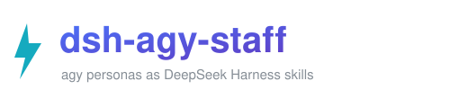

<p align="center"></p>

<p align="center"><a href="README.md">English</a> | <a href="README.zh-CN.md">简体中文</a></p>

<p align="center">   </p>

<p align="center">把 <a href="https://github.com/keli-wen/agy-staff">agy-staff</a> 的几个 personas 装成 DeepSeek Harness 技能 —— <code>/agy-ask</code>、<code>/agy-staffer</code>、<code>/agy-researcher</code>、<code>/agy-reviewer</code>、<code>/agy-implementer</code>，外加 <code>/agy-lead</code> 和 <code>/agy-jobs</code>。</p>

**[为什么 · 安装 · 用法 · 原理 · 排错 · 鸣谢](#为什么)**

## 为什么

[agy-staff](https://github.com/keli-wen/agy-staff) 把 Google 的 Antigravity CLI（`agy`，Gemini 3.8 Flash）雇成"员工"：主 agent 把一个调研、一次 review 或一段小范围实现交出去，几秒钟拿回另一个模型家族的结论，而不是自己啃同样的活。它支持 Claude Code、Codex、Pi、OpenCode。

**DeepSeek Harness 不在它支持的主机里。** dsh 没有插件市场那套 `claude plugin install`，没有 `/agy:` 冒号命名空间，也没有 `$agy` 技能选择器。dsh 有的是技能系统：每个技能是一个目录 + SKILL.md，从文件系统根目录被发现，模型用 `skill` 工具调用，你在输入框里打 `/名字`。

这个仓库就是两者之间的适配层。它不 fork agy-staff，也不把对方代码抄进来：它读你本机的 upstream checkout，把 personas 以带前缀的副本发布到 dsh 会扫描的位置。

| | Claude Code / Codex | DeepSeek Harness（本仓库） |
|---|---|---|
| 调用面 | `/agy:ask`、`$agy:ask` | `/agy-ask` |
| 发现方式 | 插件清单 | `<dshHome>/skills/<name>/SKILL.md` |
| 共享资源 | `<plugin-root>/companion` | `<dshHome>/companion`、`<dshHome>/docs` 两个 junction |
| 后台任务 | 主机各自的等待方式 | companion 的 `wait` 作为 dsh 后台任务跑 |

一句话：**dsh 的 `/` 菜单是按 frontmatter 里的技能名匹配的，不认命名空间**，所以名字里必须带 `agy` 前缀，`/agy` 才列得出来。

## 安装

**第一步 —— 依赖。** Node.js（companion 是 Node 脚本）和 [Antigravity CLI](https://antigravity.google/docs/cli/install)：

```powershell
curl -fsSL https://antigravity.google/cli/install.sh | bash
agy --version
```

Windows 上安装脚本会把 `agy.exe` 放到 `%LOCALAPPDATA%\agy\bin`，确认该目录在 `PATH` 里。

**第二步 —— clone 并跑安装器。** 它会找一个 agy-staff checkout（找不到就 clone 到 `~/agy-staff`），然后把七个技能发布到 `~/.dsh/skills`：

```powershell
git clone https://github.com/Adingo001/dsh-agy-staff.git
cd dsh-agy-staff
pwsh -File install.ps1                      # 加 -Check 只看计划不落盘
```

已经有 checkout？指过去就不会再 clone：

```powershell
pwsh -File install.ps1 -Upstream D:\project\agy-staff
```

**第三步 —— 冒烟测试。** `ask` 不碰工具，不用 setup，三秒出结果：

```powershell
node "$HOME\.dsh\companion\agy-companion.mjs" ask --prompt "reply with OK"
```

然后在输入框打 `/agy`：七行都在，不用重启 —— dsh 盯着技能根目录，目录一变就换掉整个 catalog。

## 用法

| 场景 | 这么打 |
|---|---|
| 快速第二意见 | `/agy-ask 你们后端是什么模型` |
| 通用任务 | `/agy-staffer 总结这个仓库里的 TODO` |
| 生成图片 | `/agy-staffer 画个像素风机器人吉祥物，存到 assets/mascot.png` |
| 审当前工作区 | `/agy-reviewer 审一下当前工作区` |
| 审 PR | `/agy-reviewer 审一下 PR #12` |
| 挑战方案 | `/agy-reviewer 挑一下 docs/plan.md 里迁移方案的问题` |
| 调研 | `/agy-researcher 这个仓库的鉴权是怎么走的` |
| 小范围实现 | `/agy-implementer 修掉那个不稳定的 retry 测试` |
| 编排一整件事 | `/agy-lead 调研几个方案，起草提案，然后按我的反馈改一版` |
| 任务管理 | `/agy-jobs`，或者直接说「agy 的任务好了吗」 |

只有 `ask` 是阻塞的；其余都返回 job id，靠 companion 的 `wait` 收报告。在 dsh 里把那个 `wait` 当后台任务跑，宿主就能继续干活 —— 一个 job 只开一个 wait，`exit 2` 表示还在跑。

## 原理

三层，其中只有一层是代码：

1. **上游 personas** —— agy-staff 的 `skills/<persona>/SKILL.md`，加上 `companion/agy-companion.mjs`（只用 Node 标准库）和 `templates/`。
2. **`build-skills.ps1`** —— 适配层。逐个 persona 复制到 `<dshHome>/skills/agy-<persona>`，把 `name: <persona>` 改写成 `name: agy-<persona>`，并把跨技能链接改掉（`../jobs/` → `../agy-jobs/`、`../reviewer/` → `../agy-reviewer/`）；同时维护两个 junction，让 `../../companion`、`../../docs` 照上游的写法解析。
3. **dsh 技能提供方** —— 只扫 `<dshHome>/skills` 下一层，解析 frontmatter，目录出现/变化/消失就整体重发 catalog。

改之前有四件事值得知道：

- **技能本体必须是副本，不能是 junction。** dsh 拿 `/` 的输入去匹配 frontmatter 里的**名字**，前缀得写在文件里。用 junction 名字还是 `ask`，`/agy` 永远匹配不到。
- **资源用 junction。** 从 `<dshHome>/skills/agy-ask` 里的 `../../companion` 出来落在 `<dshHome>/companion`，指向上游 checkout 才能跟着 `git pull` 自动更新。
- **名字是扁平 kebab-case。** 这里没有冒号命名空间，`/agy:ask` 不存在，只有 `agy-ask`。
- **生成目录是"认领"而不是"覆盖"。** 脚本把自己生成了什么记进 `<dshHome>/.agy-staff-skills.json`，会清掉上游已删除的 persona，也会拒绝覆盖不是它建的目录。

Windows 细节：需要 PowerShell 7；junction 用 `New-Item -ItemType Junction` 建；删链接走 `DirectoryInfo.Delete()`，避免递归删进上游 checkout。companion 自己在上游就支持 `win32`（用 PowerShell CIM 查进程身份）。

## 升级

```powershell
git -C "$HOME\agy-staff" pull          # 或者你 checkout 的位置
pwsh -File build-skills.ps1 -Upstream "$HOME\agy-staff"
```

重复执行是幂等的；`-Check` 只打印计划、不写盘。

## 卸载

```powershell
Remove-Item "$HOME\.dsh\skills\agy-*" -Recurse -Force
Remove-Item "$HOME\.dsh\companion", "$HOME\.dsh\docs"        # 只删 junction
Remove-Item "$HOME\.dsh\.agy-staff-skills.json"
```

这样删 junction 只会去掉链接，不会动它指向的 checkout。

## 排错

| 症状 | 原因 | 处理 |
|---|---|---|
| `/agy` 什么都不列 | 技能根目录没被扫，或名字没前缀 | 看 `~/.dsh/skills/agy-ask/SKILL.md` 在不在、frontmatter 是不是 `name: agy-ask` |
| `unknown subcommand: researcher` | companion 的模式是 `research` / `review` / `implement` | 用模式名，不是技能目录名 |
| `ask` 卡住或 401 | agy 需要 localhost 和 OAuth token 文件 | 别在受限沙箱里跑；`agy` 要先登录 |
| `install.ps1` 拒绝某目录 | 目标目录早于本脚本存在 | 挪走；若确认是旧输出，删掉 `<dshHome>/.agy-staff-skills.json` 再跑 |
| 技能正文里的相对链接 404 | `~/.dsh/companion` 或 `~/.dsh/docs` junction 丢了 | 重跑 `install.ps1` |

## 鸣谢

**这个项目只是适配层，不是发明者。** 让这一切值得用的东西 —— 五个 personas、companion 脚本、任务协议、提示词，以及把它们量化出来的 bench —— 都属于 [**keli-wen**](https://github.com/keli-wen) 和 [agy-staff](https://github.com/keli-wen/agy-staff) 的贡献者。请去给上游点 star；你在用这个仓库，用的其实是他们的工作。

- 上游：<https://github.com/keli-wen/agy-staff>（MIT）
- Bench v1 报告：[English](https://lastwhisper.dev/en/zen-of-harness-engineering/agy-staff-bench-v1/) · [中文](https://lastwhisper.dev/zen-of-harness-engineering/agy-staff-bench-v1/)
- 干活的模型：[Antigravity CLI](https://antigravity.google/product/antigravity-cli)

也谢谢 DeepSeek Harness 的作者们：技能系统落在文件系统这一层，才让这种移植成为可能。

## 许可

MIT —— 见 [LICENSE](LICENSE)。上游 agy-staff 的内容仍按其 MIT 许可，安装时从你的 checkout 读取，本仓库不内联任何上游源码。
