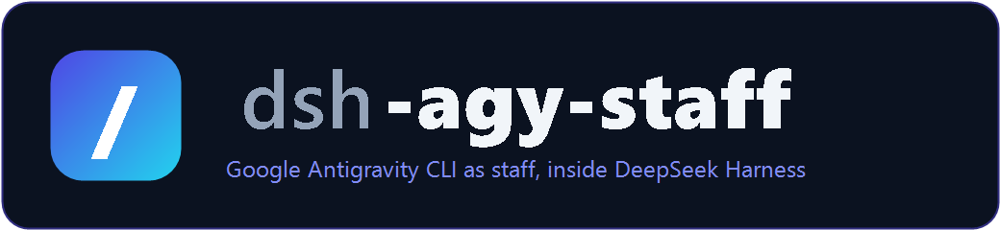
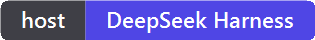
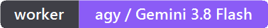

<p align="center"></p>

<p align="center"><a href="README.md">English</a> | <a href="README.zh-CN.md">简体中文</a></p>

<p align="center">   </p>

<p align="center">一个 DeepSeek Harness 插件（bundle），把 <a href="https://github.com/keli-wen/agy-staff">agy-staff</a> 的 personas 装成七个技能：<code>/agy-ask</code>、<code>/agy-staffer</code>、<code>/agy-researcher</code>、<code>/agy-reviewer</code>、<code>/agy-implementer</code>，外加 <code>/agy-lead</code> 和 <code>/agy-jobs</code>。</p>

**[为什么 · 安装 · 用法 · 原理 · 控制面板 · 更新 · 排错 · 鸣谢](#为什么)**

## 为什么

[agy-staff](https://github.com/keli-wen/agy-staff) 把 Google 的 Antigravity CLI（`agy`，Gemini 3.8 Flash）雇成"员工"：主 agent 把一个调研、一次 review 或一段小范围实现交出去，几秒钟拿回另一个模型家族的结论，而不是自己啃同样的活。它给 Claude Code、Codex、Pi、OpenCode 提供了插件。

**DeepSeek Harness 不是这类主机。** dsh 的插件是 **cordis bundle**，不是宿主插件清单；dsh 也没有 `/agy:` 命名空间 —— 输入框的 `/` 菜单匹配的是 frontmatter 里的**技能名**，技能由一个注册进去的 **skill provider** 提供。所以这个仓库不是"把文件拷来拷去的安装脚本"，而是一个 dsh bundle，注册一个 provider 来供那七个 persona：

```
dsh-agy-staff（bundle patch）
  └── row: dsh-agy-staff  (inject: ['skills'])
        └── ctx.skills.registerProvider(...)
              └── /agy-ask  /agy-staffer  /agy-researcher  /agy-reviewer
                  /agy-implementer  /agy-lead  /agy-jobs
```

不往 `~/.dsh/skills` 写任何东西，不建 junction，运行时也不需要上游 checkout：personas、companion 和参考文档都随包放在 `assets/` 里。

| | Claude Code / Codex | DeepSeek Harness（本 bundle） |
|---|---|---|
| 安装 | `claude plugin install …` | `dsh plugin --profile <p> add …` |
| 调用面 | `/agy:ask` | `/agy-ask` |
| 技能投递 | 插件清单 | `ctx.skills.registerProvider` |
| 共享资源 | `<plugin-root>/companion` | `resourceBase` → `<pkg>/assets/` |
| 生效时机 | 下一次会话 | **重启应用**（bundle 在宿主启动时加载） |
| 智能体形态 | 无 | `agy` 子智能体 provider + 工具：不用拼 shell 命令也能派活 |
| 设置 | 宿主插件设置 | 圆形 **agy** 面板：模式/模型/强度/超时、作业列表、在线自测 |

## 安装

**第一步 —— 干活的模型。** Node.js 和 [Antigravity CLI](https://antigravity.google/docs/cli/install)，先登录一次：

```powershell
curl -fsSL https://antigravity.google/cli/install.sh | bash
agy --version
```

Windows 上安装器会把 `agy.exe` 放进 `%LOCALAPPDATA%\agy\bin`，记得在 `PATH` 里。

**第二步 —— 装进 profile。** `dsh plugin` 会把参数转发给 profile 目录里的 pnpm，并把 bundle 登记进 `dsh.profile.bundles`：

```powershell
git clone https://github.com/Adingo001/dsh-agy-staff.git
dsh plugin --profile desktop add "link:$PWD/dsh-agy-staff"
```

不想留 clone 的话，直接从 GitHub 装：

```powershell
dsh plugin --profile desktop add "github:Adingo001/dsh-agy-staff"
```

**第三步 —— 重启 DeepSeek Harness。** 技能**目录**是热加载的，新 bundle 不是。退出应用再打开，然后在输入框打 `/agy`：七行。

**第四步 —— 冒烟测试。** `ask` 不碰工具，不用 setup，三秒出结果：

```powershell
node "$env:USERPROFILE\.dsh\profiles\desktop\node_modules\dsh-agy-staff\assets\companion\agy-companion.mjs" ask --prompt "reply with OK"
```

## 用法

| 场景 | 这么打 |
|---|---|
| 快速第二意见 | `/agy-ask 你们后端是什么模型` |
| 通用任务 | `/agy-staffer 总结这个仓库里的 TODO` |
| 生成图片 | `/agy-staffer 画个像素风机器人吉祥物，存到 assets/mascot.png` |
| 审当前工作区 | `/agy-reviewer 审一下当前工作区` |
| 审 PR | `/agy-reviewer 审一下 PR #12` |
| 挑战方案 | `/agy-reviewer 挑一下 docs/plan.md 里迁移方案的问题` |
| 调研 | `/agy-researcher 这个仓库的鉴权是怎么走的` |
| 小范围实现 | `/agy-implementer 修掉那个不稳定的 retry 测试` |
| 编排一整件事 | `/agy-lead 调研几个方案，起草提案，然后按我的反馈改一版` |
| 任务管理 | `/agy-jobs`，或者直接说「agy 的任务好了吗」 |

只有 `ask` 是阻塞的。其余都返回 job id，靠 companion 的 `wait` 收报告；在 dsh 里把那个 `wait` 当后台任务跑，宿主就能继续干活 —— 一个 job 只开一个 wait，`exit 2` 表示还在跑。

## 原理

- **一个 provider，七个 candidate。** `index.js` 解析随包的 `assets/skills/<persona>/SKILL.md` frontmatter，正文即技能内容，`rank: 600`（打包 provider 的优先级）。零依赖，只用 Node 内置模块。
- **名字前缀是硬需求。** dsh 没有冒号命名空间，只有名字以 `agy` 开头才会被 `/agy` 列出来。所以对外供的是 `agy-<persona>`，磁盘上的目录保留上游的 `ask`/`jobs` —— 这样正文里的 `../jobs/SKILL.md` 原样就能解析。
- **所有路径在喂给模型之前就解析完。** 上游写的是 `<skill-dir>/../../companion/agy-companion.mjs`，把解析留给宿主；在 dsh 里这句话读起来像谜语（"skill dir 是 assets\ask？"），于是每个新会话都要浪费一轮去 glob 找 companion、再浪费一轮纠错。现在 provider 把 `<skill-dir>`、`<plugin-root>`、`../jobs/…`、`../../companion/…`、`../../docs/…` 全部改写成绝对路径，并在正文最前面放一段"已解析，别去找"的说明。命令照抄就能跑，第一次就对，每次都对 —— 磁盘上的 vendored 文件不动。
- **`resourceBase` 仍然声明。** `{ kind: 'directory', path: <pkg>/assets }` 留作兜底：改写没覆盖到的引用（比如上游明天新加的）照样能解析。
- **`agy` 同时是子智能体。** `agy-subagent.js` 注册一个进程外的 `SubagentProvider`，bundle 再用 `@deepseek-ai/dsh-tool-subagent` 挂出 `provider: agy, toolName: agy` —— 模型可以把整件事直接派给 Antigravity 当一个子 agent，而不用自己拼 shell 命令、盯 job id。能力位一律声明 `false`（没有 `agentOptions`/`agentPreset`/`outputSchema`/深度限制），因为跨进程的子 agent 兑现不了这些，且不继承父会话上下文。环境变量：`DSH_AGY_SUBAGENT_MODE`（默认 `staffer`）、`DSH_AGY_SUBAGENT_TIMEOUT_MS`、`DSH_AGY_COMPANION`。
- **文案在加载时本地化。** 上游正文写的是 `/agy:ask`；provider 在 description 和正文里改写成 `/agy-ask`，磁盘上的 vendored 文件保持与上游逐字节一致。
- **上游是 vendored，而不是安装时才拷。** `assets/` 里是 personas、companion、templates 和参考文档，版本记在 `assets/UPSTREAM-COMMIT`；`NOTICE` 写清了每一块的来源。

## 控制面板

bundle 里带一个浏览器端小面板（`dsh.client` → `client.js`，注册进 `shell.overlay` 槽位）和一条给它喂数据的宿主路由：`POST /agy/api`。重启后输入框右侧上方会多一个圆形 **agy** 按钮。

| 面板区 | 作用 |
|---|---|
| 环境 | companion 路径（✓/✗）、`agy --version`、插件版本、配置文件路径 |
| 委派配置 | 模式（`staffer`/`research`/`review`/`implement`/`ask`）、推理强度、模型覆盖、超时；两个开关分别管 `agy` 子智能体和 `/agy-*` 技能 |
| 连通性测试 | 跑一次 `ask` 并显示耗时 —— 「agy 到底通不通」按钮 |
| 作业 | 从 `<cwd>/.agy-staff/state.json` 读最近作业，可**看结果**、可**取消** |

保存的值每次委派都从 `<dshHome>/agy-staff/settings.json` 现读，所以**保存即时生效，不用重启**；只有 bundle 行（面板本身、工具、两个 provider）是应用启动时固定的。

路由只认同源：跨站在 `Origin`/`Sec-Fetch-Site` 上就被拒，且必须 `content-type: application/json` —— 随便哪个网页都没法通过回环地址驱动 agy。
## 更新

上游有更新：

```powershell
git -C <agy-staff-checkout> pull
node scripts/vendor-upstream.mjs --from <agy-staff-checkout>
npm test
```

然后重启应用。`scripts/vendor-upstream.mjs` 负责复制、重写 `assets/UPSTREAM-COMMIT`，并在上游删掉某个路径时给警告。

本 bundle 自身：

```powershell
git pull
dsh plugin --profile desktop add "link:$PWD"   # 换过位置就重新 link
```

## 排错

| 症状 | 原因 | 处理 |
|---|---|---|
| `/agy` 什么都不列 | bundle 行没加载 | 确认 profile 的 `dsh.profile.bundles` 里有 `dsh-agy-staff`，然后重启应用 |
| 警告重复技能 `agy-ask` | 旧的"拷到 `~/.dsh/skills`"那套装法还在 | 删掉 `~/.dsh/skills/agy-*`（本 bundle 接管） |
| `unknown subcommand: researcher` | companion 的模式是 `research` / `review` / `implement` | 用模式名，不是技能目录名 |
| `ask` 卡住或 401 | agy 需要 localhost 端口和 OAuth token | 别在受限沙箱里跑；`agy` 先登录一次 |
| 技能正文里的相对路径 404 | `assets/` 被手工改坏了 | 重跑 `node scripts/vendor-upstream.mjs` |
| 重装后整个消失 | 行 id 变成了 pnpm 解析不了的包名 | `dsh plugin --profile desktop why dsh-agy-staff` |

## 鸣谢

**这个项目只是适配层，不是发明者。** 让这一切值得用的东西 —— 五个 personas、companion、任务协议、提示词，以及把它们量化出来的 bench —— 都属于 [**keli-wen**](https://github.com/keli-wen) 和 [agy-staff](https://github.com/keli-wen/agy-staff) 的贡献者。请去给上游点 star；你在用这个 bundle，用的其实是他们的工作。

- 上游：<https://github.com/keli-wen/agy-staff>（MIT，vendored 于 `9ddec3e`）
- Bench v1 报告：[English](https://lastwhisper.dev/en/zen-of-harness-engineering/agy-staff-bench-v1/) · [中文](https://lastwhisper.dev/zen-of-harness-engineering/agy-staff-bench-v1/)
- 干活的模型：[Antigravity CLI](https://antigravity.google/product/antigravity-cli)

也谢谢 DeepSeek Harness 的作者们：技能注册表接受任意 bundle 注册 provider，才让"真正的插件"这一版成为可能。

## 许可

MIT —— 本 bundle 的代码见 [LICENSE](LICENSE)；vendored 的上游材料见 [NOTICE](NOTICE)，仍按其 MIT 许可（`assets/UPSTREAM-LICENSE`）。
